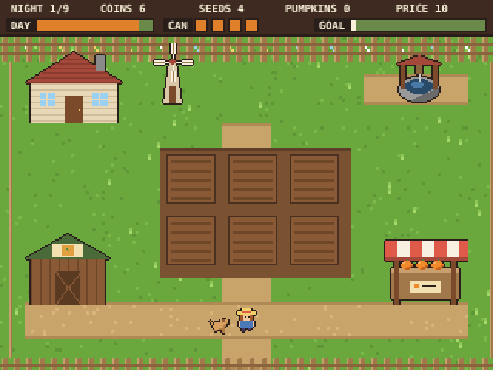
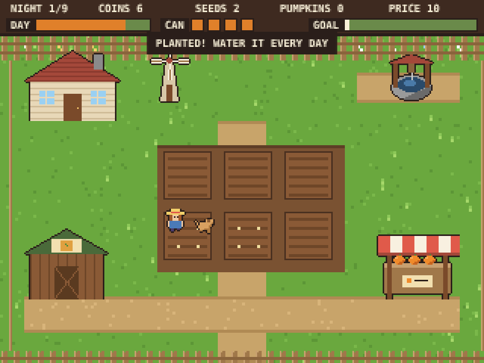
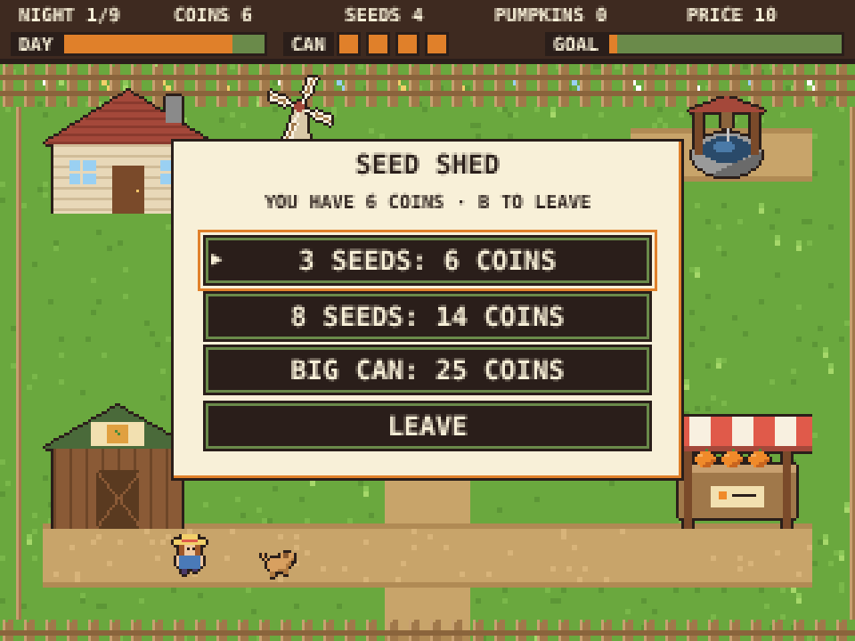
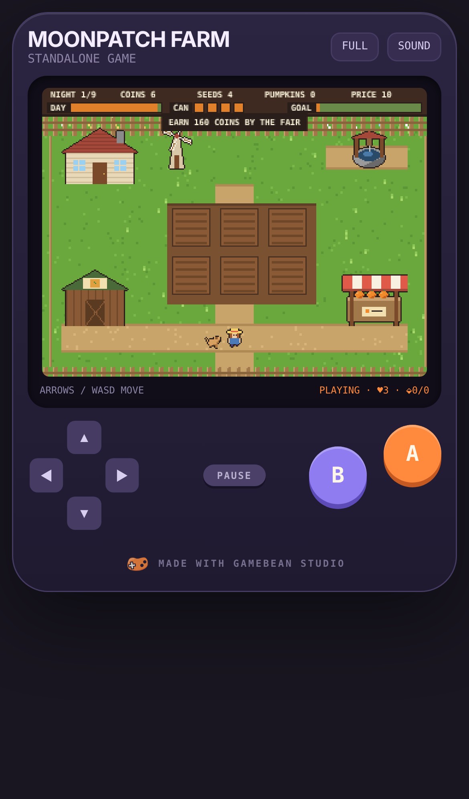

# Moonpatch Farm

A farming game made with [GameBean Studio](https://github.com/icakinser/gamebean-studio). You are Juniper, and the harvest fair is nine nights away. Plant pumpkins, water them every day, harvest them and sell them at a price that changes every night. Earn 160 coins before the fair to win the blue ribbon.

## Play

- **In a browser:** download `index.html` and open it. On a phone, use the on-screen pad to walk.
- **In GameBean Studio:** **FILE > Open…** > **Browse this computer…** and pick `moonpatch-farm-cartridge.json` (or `index.html`) to open it in the editor. It is also under **Full games** in **FILE > New Game…**.

The controls are listed under **Controls in the finished game** below.

| | |
| --- | --- |
|  |  |
|  |  |

---

## Build it yourself

**Moonpatch Farm** is a farming game on one screen. You are **Juniper**, and the harvest fair is nine nights away. Plant pumpkin seeds, water them every day, harvest them and sell them at the market stall. Earn **160 coins** before the fair and your farm wins the blue ribbon.

How a day goes:

1. **Walk onto a plot.** An empty plot is **planted** (it costs a seed). A planted plot is **watered** (it costs one can of water). A ripe pumpkin is **harvested**.
2. **Night falls** when the day meter runs out (24 seconds). Every plot that was watered grows one stage: seed, sprout, ripe pumpkin. Then it dries out, so water it again tomorrow.
3. **The well** fills your can. **The stall** buys all your pumpkins at today's price, which changes every night (8 to 14 coins). **The seed shed** sells seeds and a bigger can.

It shows off:

- **Object variables:** each plot keeps its own `stage` and `water`, so six plots share one set of rules.
- **Select case** on the stage (plant, water or harvest), and a **Calculate** that turns two numbers into one (`look = stage * 10 + water`) to pick the plot's picture.
- A day clock made from a rule **timer**, **Fade screen** at night, **Random number** for the price.
- A shop: a **Panel** that pauses the game (B closes it) with a **Menu**, and **Set bean setting** to make the can meter bigger.
- **Follower** (Biscuit the dog), **Animation state**, **Particles**, **Sound cue**, a **Music zone** with its own song at the market, a **Music maker** song and **Sound maker** sounds.

**What you will learn:** a top-down hero with pictures, many objects that share rules but keep their own numbers, a clock, a shop window, and a goal you check every night.

**Time:** about 50 minutes.

---

## Before you start

### Learn the editor moves

If you have not used the GameBean Studio editor before, read **[GameBean Studio editor basics](EDITOR-BASICS.md)** first. The moves you will repeat most:

| The tutorial says                                          | You do                                                                                                                                                          |
| ---------------------------------------------------------- | --------------------------------------------------------------------------------------------------------------------------------------------------------------- |
| **Place a Spikes**                                         | Toolbox > **OBJECTS** tab > click **Spikes** > click the map > click **DONE** ([§8](EDITOR-BASICS.md#8-place-an-object))                                        |
| **Name it Well, at `256, 36, 32 × 32`**                    | In the inspector type the name, then X, Y, W and H ([§9](EDITOR-BASICS.md#9-name-an-object-and-type-its-position-and-size))                                     |
| **Remove Hazard**                                          | Click the **×** on the Hazard card ([§10](EDITOR-BASICS.md#10-bean-cards-turn-off-reorder-remove-and-change-settings))                                          |
| **Add Label (Actions)**                                    | **ADD ACTION** > type "Label" in the search box > click **Label** ([§11](EDITOR-BASICS.md#11-add-a-bean))                                                       |
| **Sprite `well/idle.png`**                                 | **SPRITE** > **IMPORT PNG / SHEET** > pick the file from this tutorial's `sprites` folder > **SAVE SPRITE** ([§15](EDITOR-BASICS.md#15-sprites-import-or-draw)) |
| **`WHEN On collision · IF other has tag (player) · DO …`** | **ADVANCED** > **ADD LOGIC RULE**, then fill in WHEN, IF and the DO list ([§14](EDITOR-BASICS.md#14-rules-when--do-))                                           |

Anything a step does not mention stays at its default.

### Get the sprite files

The pictures are in the [`sprites/moonpatch-farm`](sprites/moonpatch-farm) folder next to this tutorial (on GitHub: **Code > Download ZIP**, then unzip).

| Folder                           | Animations                                               | Used by              |
| -------------------------------- | -------------------------------------------------------- | -------------------- |
| `field`                          | `idle`                                                   | The grass and paths  |
| `fence`, `fence-post`            | `idle`                                                   | The fences (tiles)   |
| `house`, `well`, `shed`, `stall` | `idle`                                                   | The buildings        |
| `windmill`                       | `idle` (4 frames)                                        | The turning windmill |
| `farmer`                         | `idle`, `move` (2 frames)                                | Juniper              |
| `dog`                            | `idle` (2), `move` (2)                                   | Biscuit              |
| `plot`                           | `idle`, `seed`, `seedwet`, `sprout`, `sproutwet`, `ripe` | The six plots        |

A file name like `idle-2.png` is frame 2 of `idle`: import frame 1, click **DUPLICATE FRAME**, then import frame 2 into the new frame.

### Keep the finished game open for comparison

Open a second window, click **BUILD**, then **FILE > New Game…** > **MOONPATCH FARM** (under Full games). Play a day. Click any object to see its beans and rules.

### Controls in the finished game

| Key or touch  | Does                                    |
| ------------- | --------------------------------------- |
| Arrows        | Walk (onto a plot, the well, the stall) |
| Up / Down + A | Choose and buy in the seed shed         |
| B / X         | Leave the seed shed                     |
| Enter         | Pause                                   |

---

## Part 1: Set up the game

1. **BUILD** > **FILE > New Game…** > **BLANK GAME** ([§2](EDITOR-BASICS.md#2-start-a-new-game)).
2. Name the scene **MOONPATCH FARM**, **W** = 320, **H** = 240.
3. **LEVEL SETTINGS**: **CAMERA** = **Fixed**, **SKY** = **Clear**, **HORIZON** = **None**, **INTRO** = `EARN 160 COINS BY THE FAIR`.
4. A palette called **Moonpatch** ([§7](EDITOR-BASICS.md#7-make-your-own-palette)): Ink `#2a1e1a`, Dark `#e0802a`, Light `#6a8a4a`, Paper `#f8f0d8`. It colours the words and meters.
5. **VARIABLES**: name the first eleven slots:

   | Slot | Name     | Start | Holds                         |
   | ---- | -------- | ----- | ----------------------------- |
   | 1    | `night`  | 1     | Which night it is             |
   | 2    | `coins`  | 6     | Your coins                    |
   | 3    | `seeds`  | 4     | Seeds in your pocket          |
   | 4    | `crops`  | 0     | Pumpkins you carry            |
   | 5    | `can`    | 4     | Water left in the can         |
   | 6    | `canmax` | 4     | How much the can holds        |
   | 7    | `sun`    | 24    | Seconds of daylight left      |
   | 8    | `price`  | 10    | Today's price for one pumpkin |
   | 9    | `earned` | 0     | What the last sale made       |
   | 10   | `pick`   | 0     | What you picked in the shop   |
   | 11   | `bigcan` | 0     | 1 once you own the big can    |

6. **SOUNDS**: Sound 1 **Splash** (a **Boom** with cut bass), Sound 2 **Plant** (a **Blip**), Sound 3 **Coins** (a **Coin**).
7. **MUSIC**: a song **Moonpatch Waltz** (tempo 120, **PLAYS AS** = **Song 1 + Main theme**) and a second song **Market Jig** (tempo 160, **PLAYS AS** = **Song 2 only**). Use **Surprise me**, or place your own notes.

---

## Part 2: The farm

Place these in this order, so the field is at the back. For each: place, name, position, then the beans and sprite given.

| Name         | Kind   | At                 | Beans                | Sprite                                             |
| ------------ | ------ | ------------------ | -------------------- | -------------------------------------------------- |
| Field        | Spikes | `0, 0, 320 × 240`  | remove Hazard        | `field/idle.png`                                   |
| Fence top    | Brick  | `0, 24, 320 × 16`  | (Solid, as it comes) | `fence/idle.png`, ON BIG OBJECTS = Repeat as tiles |
| Fence bottom | Brick  | `0, 232, 320 × 8`  |                      | `fence/idle.png`, Repeat as tiles                  |
| Fence left   | Brick  | `0, 40, 8 × 192`   |                      | `fence-post/idle.png`, Repeat as tiles             |
| Fence right  | Brick  | `312, 40, 8 × 192` |                      | `fence-post/idle.png`, Repeat as tiles             |
| Farmhouse    | Brick  | `16, 32, 64 × 48`  |                      | `house/idle.png`                                   |
| Windmill     | Spikes | `96, 28, 32 × 40`  | remove Hazard        | `windmill/idle-1…4.png`, FRAME TIME 0.25           |

The bricks are solid, so Juniper walks around the buildings and can't leave the farm.

---

## Part 3: Juniper and Biscuit

1. Click the **Hero**. Name it **Juniper**, at `152, 200, 16 × 16`. Remove every bean, then add **Top-down move** (Actions): **Top speed** 90. Add **Animation state** (Actions): **Playback speed ×** 1.5, so her steps keep up with her.
2. **Sprite**: `farmer/idle.png`, and `move` = `move-1.png`, `move-2.png` (FRAME TIME 0.18).
3. Place a **Spikes**: **Biscuit**, at `172, 202, 14 × 14`. Remove Hazard. Add **Follower** (Actions): **Stay behind by** 18, **Float above by** -2, **Catch-up speed** 4. Sprite: the `dog` pictures.

A Spikes with no Hazard is harmless, so Biscuit can trot along anywhere.

> **Check:** **PLAY**. Juniper walks around the farm with Biscuit at her heels.

---

## Part 4: The plots

Build **Plot 1** completely, then copy it five times.

1. Place a **Spikes**: **Plot 1**, at `108, 100, 32 × 32`. Remove Hazard.
2. **Sprite**: `idle` = `plot/idle.png`. Add animations `seed`, `seedwet`, `sprout`, `sproutwet` and `ripe`, each with its picture.
3. Add **Particles** (Actions): **Style** = Confetti, **Amount** 14, **When** = **Only when run by a bean**.
4. **ADVANCED** > **OBJECT VARIABLES**: `stage` 0, `water` 0, `look` 0. Stage 0 is empty, 1 a seed, 2 a sprout, 3 a ripe pumpkin.
5. Rule 1: `WHEN On collision · IF other has tag (player)`. **DO**:
   - **Select case** on `stage`:
     - **CASE 0**: **If / Else**, IF **formula** `seeds > 0`:
       - THEN: **Set variable** `stage` = 1, **Set variable** `water` = 0, **Add to variable** `seeds` -1, **Play sound** (pickup, Sound maker: **Plant**), **Show text** `PLANTED! WATER IT EVERY DAY` (1.6 s).
       - ELSE: **Show text** `NO SEEDS! BUY SOME AT THE SHED`.
     - **CASE 1 TO 2**: **If / Else**, IF **formula** `water = 1`:
       - THEN: **Show text** `ALREADY WATERED TODAY`.
       - ELSE: **If / Else**, IF **formula** `can > 0`: **Set variable** `water` = 1, **Add to variable** `can` -1, **Play sound** (pickup, Sound maker: **Splash**), **Show text** `WATERED`. ELSE: **Show text** `THE CAN IS EMPTY! FILL IT AT THE WELL`.
     - **CASE 3**: **Set variable** `stage` = 0, **Set variable** `water` = 0, **Add to variable** `crops` 1, **Run bean** Particles, **Play sound** (pickup), **Show text** `A PUMPKIN! SELL IT AT THE STALL`.
   - **Send message** `look`.
6. Rule 2, the night: `WHEN On message (nightfall)`:
   - **If / Else**, IF **formula** `water = 1 and stage >= 1 and stage < 3`: **Add to variable** `stage` 1.
   - **Set variable** `water` = 0, **Send message** `look`.
7. Rule 3, the picture: `WHEN On message (look)`:
   - **Calculate** `look` = `stage * 10 + water`
   - **Select case** on `look`: **CASE 10**: **Play animation** `seed`. **CASE 11**: `seedwet`. **CASE 20**: `sprout`. **CASE 21**: `sproutwet`. **CASE 30 TO 31**: `ripe`. **CASE ELSE**: `idle`.

Because `stage`, `water` and `look` are the plot's own variables, every copy keeps its own numbers.

8. Copy **Plot 1** five times (**Ctrl+D**) and place them in two rows of three:

   | Name   | At         |
   | ------ | ---------- |
   | Plot 2 | `148, 100` |
   | Plot 3 | `188, 100` |
   | Plot 4 | `108, 140` |
   | Plot 5 | `148, 140` |
   | Plot 6 | `188, 140` |

> **Check:** **PLAY**. Walk onto a plot: it is planted and shows a seed. Walk off and on again: it is watered and the soil goes dark.

---

## Part 5: The well, the stall and the shed

1. **Well**: a **Brick** at `256, 36, 32 × 32`, sprite `well/idle.png`. Add **Sound cue**: **Sound** = Sound 1 (Splash), **When** = **Hero touches this**. Rule: `WHEN On collision · IF other has tag (player) · DO Variable math with variable (can = canmax), Show text (THE CAN IS FULL ({can}))`.
2. **Market stall**: a **Brick** at `248, 150, 56 × 48`, sprite `stall/idle.png`. Rule: `WHEN On collision · IF other has tag (player)`:
   - **If / Else**, IF **formula** `crops > 0`:
     - THEN: **Calculate** `earned` = `crops * price`, **Variable math with variable** `coins` `+` `earned`, **Set variable** `crops` = 0, **Play sound** (pickup, Sound maker: **Coins**), **Show text** `SOLD FOR {earned} COINS!`, then **If / Else**, IF **formula** `coins >= 160`: **Show text** `GOAL REACHED! WAIT FOR THE FAIR` (2.5 s).
     - ELSE: **Show text** `BRING PUMPKINS! TODAY: {price} EACH`.
3. **Market tune**: a **Spikes** at `216, 112, 96 × 120`, Hazard removed, a see-through sprite. Add **Music zone**: **Track** = **Song 2**, **Leaving** = **Back to the music before**. The jig plays while Juniper is near the stall.
4. **Seed shed**: a **Brick** at `16, 150, 56 × 48`, sprite `shed/idle.png`. Its rule opens the shop; you add it in Part 6, once the shop exists.

---

## Part 6: The shop window

1. **Shop panel**: a **Spikes** at `64, 52, 192 × 128`, Hazard removed. Add **Panel**: **Panel number** 1, **Look** = Light window, **Starts open** = No, **While open** = **Game pauses, B closes it**. **UI TEXT** = `SEED SHED`.
2. **Shop coins**, on top of it: a **Spikes** at `72, 70, 176 × 12` with **Label** (Text size Small, Align Centre, Look Dark text). **UI TEXT** = `YOU HAVE {coins} COINS · B TO LEAVE`.
3. **Shop menu**: a **Spikes** at `76, 88, 168 × 80` with **Menu** (Text size Medium, Look Dark, **Store choice in** = Variable 10 `pick`, Send the option as a message = No). **UI TEXT** = four lines: `3 SEEDS: 6 COINS`, `8 SEEDS: 14 COINS`, `BIG CAN: 25 COINS`, `LEAVE`.
   - Rule: `WHEN On menu choice · TARGET named (Shop panel)`. **DO**: **Select case** on `pick`:
     - **CASE 1**: **If / Else**, IF **formula** `coins >= 6`: **Add to variable** `coins` -6, **Add to variable** `seeds` 3, **Show text** `+3 SEEDS`. ELSE: **Show text** `NOT ENOUGH COINS`.
     - **CASE 2**: the same with 14 coins and 8 seeds (`+8 SEEDS`).
     - **CASE 3**: **If / Else**, IF **formula** `bigcan = 0 and coins >= 25`: **Add to variable** `coins` -25, **Set variable** `bigcan` = 1, **Set variable** `canmax` = 8, **Set variable** `can` = 8, **Send message** `bigcan`, **Show text** `A BIG CAN: 8 WATERINGS!`. ELSE: **Show text** `ALREADY YOURS, OR NOT ENOUGH COINS`.
     - **CASE ELSE** (LEAVE): **Show / hide** (hide). The TARGET is the panel, so this closes the shop.
4. Back on the **Seed shed**: `WHEN On collision · IF other has tag (player) · TARGET named (Shop panel) · DO Show / hide (show)`.

> **Check:** walk into the shed. The window opens and the farm stops. Buy 3 seeds, then press **B**.

---

## Part 7: The top bar

The game hides the built-in top bar and shows its own. Each Label is a **Spikes** with Hazard removed and **Label** (Text size Small, Align Left, Look Light text); each Meter has **Shows** = A variable.

| Name           | At                 | Bean and settings                                | UI TEXT            |
| -------------- | ------------------ | ------------------------------------------------ | ------------------ |
| Night label    | `4, 1, 56 × 10`    | Label                                            | `NIGHT {night}/9`  |
| Coins label    | `62, 1, 62 × 10`   | Label                                            | `COINS {coins}`    |
| Seeds label    | `126, 1, 54 × 10`  | Label                                            | `SEEDS {seeds}`    |
| Pumpkins label | `182, 1, 70 × 10`  | Label                                            | `PUMPKINS {crops}` |
| Price label    | `254, 1, 64 × 10`  | Label                                            | `PRICE {price}`    |
| Day meter      | `4, 12, 96 × 9`    | Meter: Variable 7 `sun`, Full at 24, Look Bar    | `DAY`              |
| Can meter      | `106, 12, 92 × 9`  | Meter: Variable 5 `can`, Full at 4, Look Pips    | `CAN`              |
| Goal meter     | `204, 12, 112 × 9` | Meter: Variable 2 `coins`, Full at 160, Look Bar | `GOAL`             |

The **Can meter** grows with the big can. Give it a rule: `WHEN On message (bigcan) · DO Set bean setting (Meter > Full at, from variable canmax)`.

---

## Part 8: The moon clock

The clock is an invisible object with three rules. It also hides the built-in top bar.

1. Place a **Spikes**: **Moon clock**, at `0, 0, 16 × 16`. Remove Hazard, see-through sprite. Add **Environment settings**: **Top bar (hearts, score, clock)** = **Hide**.
2. `WHEN On start · DO Start timer (tick, 1 second)`.
3. `WHEN On timer (tick)`: **Add to variable** `sun` -1, **If / Else** IF **formula** `sun <= 0`: **Send message** `nightfall`. Then **Start timer** (tick, 1 second) again, so it ticks every second.
4. `WHEN On message (nightfall)`:
   - **Fade screen** (out, light, 0.5 s)
   - **Set variable** `sun` = 24, **Add to variable** `night` 1
   - **Random number** `price`, 8 to 14
   - **Select case** on `night`: **CASE 10 TO 99**: **Show text** `THE HARVEST FAIR IS TODAY!` (2 s). **CASE ELSE**: **Show text** `NIGHT {night}: PUMPKINS SELL FOR {price}` (2.2 s).
   - **If / Else**, IF **formula** `coins >= 160`: **Win / lose the game** (win, `A BLUE RIBBON FARM!`).
   - **If / Else**, IF **formula** `night > 9`: **Win / lose the game** (lose, `THE FAIR CAME AND WENT`).
   - **Fade screen** (in, light, 0.8 s)

Every plot hears the same `nightfall` message and grows.

---

## Part 9: Play it

1. **PLAY**. Plant all four seeds, water them, then fill the can at the well.
2. Water each planted plot once every day. After two nights with water a pumpkin is ripe.
3. Harvest, then sell at the stall when the price is good (the top bar shows it). Spend coins on more seeds and the big can.
4. Reach 160 coins and wait for nightfall to win.

> **If something is off:** a plot never grows? It must be watered (dark soil) before nightfall, and its nightfall rule needs `water = 1`. The picture doesn't change? Check the `look` rule's case numbers. The shop opens but won't close? The Shop menu's rule needs TARGET = Shop panel. Night never comes? The clock's timer rule must start the timer again.

---

## Make it your own

- **A harder season:** a goal of 250 coins (change the Goal meter and both `160` formulas), or a shorter day (`sun` = 18).
- **A crop that grows faster:** a CASE in the night rule that grows two stages when `bigcan = 1`.
- **More plots:** copy a plot again; it brings its own numbers and all three rules.
- **Rainy days:** in the nightfall rule, a **Random number** `rain` 1 to 4; when it is 4, **Send message** `rain` and give each plot a rule that sets `water` = 1.
